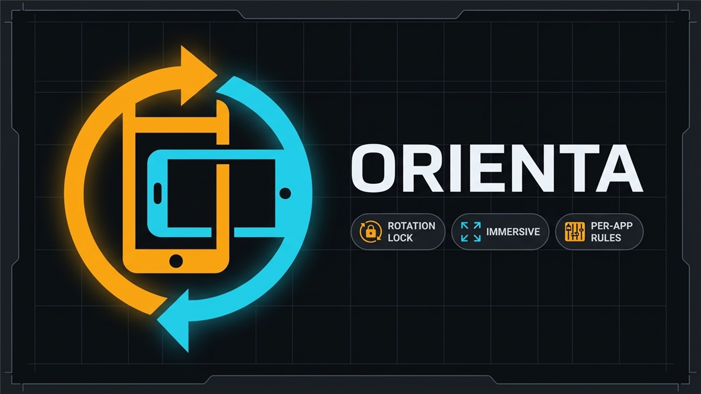
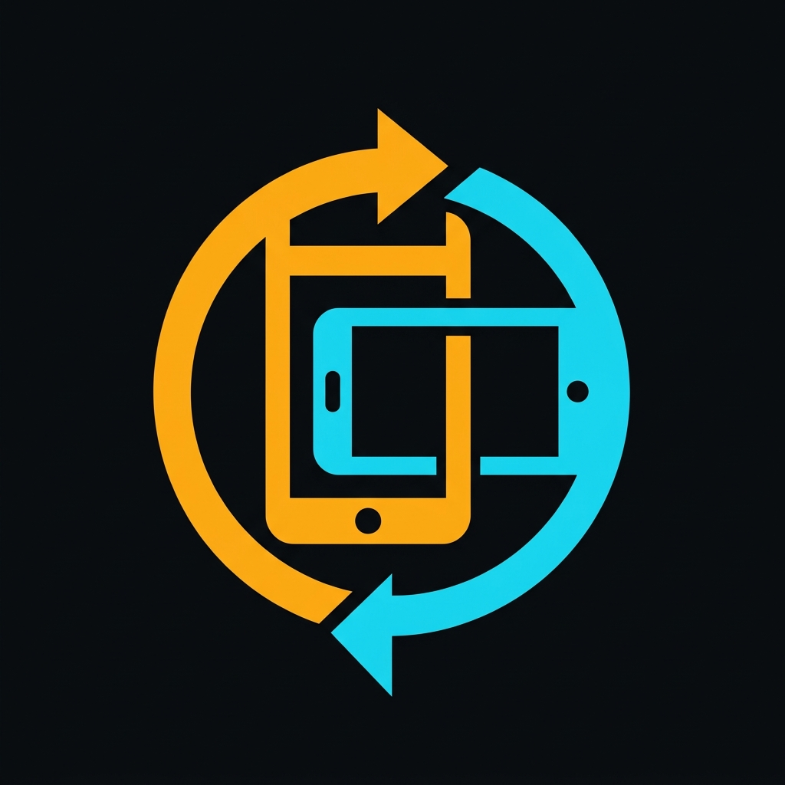
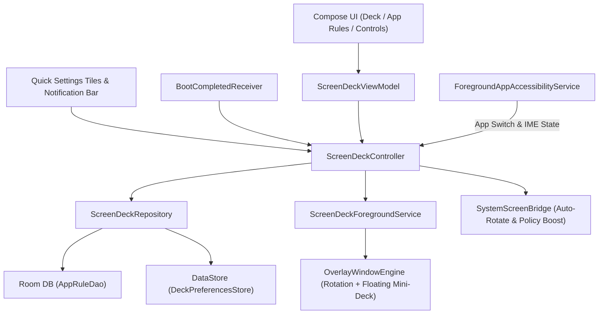

<div align="center">



<br /><br />



# Orienta

**Precision dark-mode Android control deck for universal screen rotation locking, fullscreen immersive mode, per-app automation rules, and floating quick controls.**

[](https://github.com/Suha-s-h/Orienta/actions/workflows/build-apk.yml)
[](https://github.com/Suha-s-h/Orienta/releases)
[-22D3EE?style=flat-square&logo=android&logoColor=white)](https://developer.android.com/about/versions/nougat)
[](https://kotlinlang.org/)
[](https://developer.android.com/compose)
[](#permissions-transparency)
[](LICENSE)

[Features](#-features) • [Download & Install](#-download--install) • [Permissions](#-permissions-transparency) • [Architecture](#-architecture) • [Contributing](#-contributing)

</div>

---

## Why Orienta?

Most Android rotation or fullscreen utilities rely on dated UIs, background polling loops that drain battery, or root access. **Orienta** combines universal orientation overrides and fullscreen immersive control inside a crisp, AMOLED-friendly **Tactile Control Deck** built with Jetpack Compose:

- **No Root Required** — Works out of the box with standard Android permissions (`Display over other apps` + optional `Accessibility Service`).
- **Battery-First Event-Driven Engine** — Zero background polling loops. Foreground app changes are detected via event-driven `AccessibilityService` callbacks, and `WindowManager` overlays only update when state actually changes.
- **Smart Keyboard Auto-Yield** — Automatically suspends immersive bar hiding whenever an on-screen keyboard appears so typing, messaging, and search bars never get blocked or clipped.
- **100% Offline & Private** — Requests **zero** `INTERNET` permission, includes **zero** analytics or ad SDKs, and stores all per-app rules locally on your device.
- **AMOLED Dark Instrument Palette** — Engineered around Obsidian (`#0B0D10`), Signal Amber (`#F5A524`), Laser Cyan (`#22D3EE`), and optional OLED edge masking.

---

## ✨ Features

### 1. Universal Rotation Matrix (8 Modes)
Override app-declared orientation locks system-wide—force vertical apps into landscape on tablets, flip upside-down while charging, or enable true 360° rotation:

| Mode | Badge | Angle | Behavior |
| :--- | :---: | :---: | :--- |
| **Auto System** | `AUTO` | `SYS` | Follow system sensor and default app behavior |
| **Full Sensor** | `4-WAY` | `360°` | Rotate freely in all 4 orientations including upside-down |
| **Portrait** | `PORT` | `0°` | Force upright vertical lock across all apps |
| **Rev Portrait** | `R-PORT` | `180°` | Force inverted upside-down portrait orientation |
| **Sensor Port** | `S-PORT` | `0°/180°` | Flip automatically between upright and reverse portrait |
| **Landscape** | `LAND` | `90°` | Force horizontal landscape lock across any app |
| **Rev Land** | `R-LAND` | `270°` | Force flipped horizontal landscape orientation |
| **Sensor Land** | `S-LAND` | `90°/270°` | Flip automatically between left and right landscape |

### 2. Fullscreen Immersive Matrix (4 Modes)
Hide distracting status icons, clocks, or navigation gesture pills for reading, gaming, or OLED burn-in protection:

| Mode | Badge | Scope | Behavior |
| :--- | :---: | :---: | :--- |
| **Normal Bars** | `STD` | None | Standard system status and navigation bars |
| **Hide Status** | `TOP` | Status Bar | Conceals top status clock and notification icons |
| **Hide Nav Bar** | `BTM` | Navigation Bar | Conceals bottom gesture pill or 3-button nav bar |
| **Full Immersive** | `MAX` | Both Bars | Edge-to-edge immersion hiding both top and bottom bars |

### 3. One-Tap Quick Presets
Switch instantly between calibrated profiles from the **Deck** screen:
- **Cinema** — `Sensor Land` + `Full Immersive` + Global Guard
- **Gaming** — `Landscape` + `Full Immersive` + Global Guard
- **Reader** — `Portrait` + `Hide Status` + Global Guard
- **Desk Dock** — `Full Sensor (4-Way)` + `Normal Bars` + Global Guard
- **System Std** — `Auto System` + `Normal Bars` (clean reset)

### 4. Per-App Automation Rules
Assign custom rotation and immersive profiles to individual installed apps using the **App Rules** tab:
- Searchable list of launchable apps stored locally via **Room**.
- Instant rule application when switching apps via `ForegroundAppAccessibilityService`.
- Quick toggle & delete controls per app.

### 5. Control Surfaces Everywhere
- **Floating Mini-Deck:** Draggable system overlay pill with customizable size (`Compact 40dp`, `Standard 48dp`, `Large 56dp`), opacity slider, and automatic edge-snapping.
- **Persistent Notification Control Bar:** One-tap quick toggles for Rotation, Immersive mode, Guard status, and single-tap Exit directly from the notification shade.
- **Quick Settings Tiles:** Dedicated `Rotation Lock` and `Fullscreen Mode` tiles for Android's Quick Settings panel.
- **Auto-Start on Boot:** Optionally restore your active deck automatically after device reboot or app update.

---

## 📥 Download & Install

### Option 1: GitHub Releases / Actions APK
1. Go to [**Releases**](https://github.com/Suha-s-h/Orienta/releases) (or the latest green run in [**Actions**](https://github.com/Suha-s-h/Orienta/actions/workflows/build-apk.yml)).
2. Download the `.apk` asset onto your Android device (`Android 7.0+` / API 24–36).
3. Install the APK and open **Controls -> Permissions** inside Orienta to grant your desired permissions.

### Option 2: Build from Source
Requirements: **JDK 17** and **Android SDK** (API 36).

```bash
git clone https://github.com/Suha-s-h/Orienta.git
cd Orienta
./gradlew assembleDebug
```
The built APK is generated at `app/build/outputs/apk/debug/app-debug.apk`.

### Optional: ADB Immersive Boost (No Root)
Orienta works without ADB, but granting `WRITE_SECURE_SETTINGS` once via ADB enables system `policy_control` boost on supported Android builds:

```bash
adb shell pm grant com.aistudio.screendeck.k7m2vx android.permission.WRITE_SECURE_SETTINGS
```

---

## 🔐 Permissions Transparency

Orienta is **100% offline**—it does **not** declare `android.permission.INTERNET`. Every permission declared in [`AndroidManifest.xml`](app/src/main/AndroidManifest.xml) has a strict functional purpose:

| Permission | Requirement | Purpose |
| :--- | :---: | :--- |
| `SYSTEM_ALERT_WINDOW` | **Core** | Enforces global screen orientation lock and renders the optional Floating Mini-Deck over other apps. |
| `BIND_ACCESSIBILITY_SERVICE` | **Recommended** | Event-driven detection of foreground app switches (for Per-App Rules), soft keyboard visibility (Smart Keyboard Auto-Yield), and seamless immersive overlays. |
| `POST_NOTIFICATIONS` | **Recommended** | Displays the persistent Notification Control Bar and Android 13+ foreground service status. |
| `FOREGROUND_SERVICE` / `SPECIAL_USE` | **Automatic** | Keeps the orientation/overlay controller alive reliably while Global Guard is active. |
| `WRITE_SETTINGS` | **Optional** | Syncs Android's system Auto-Rotate toggle cleanly with Orienta's active mode. |
| `RECEIVE_BOOT_COMPLETED` | **Optional** | Restores your active Orienta configuration after device reboot if enabled in settings. |
| `VIBRATE` | **Optional** | Subtle tactile haptic feedback when toggling matrix controls. |
| `WRITE_SECURE_SETTINGS` | **Optional (ADB)** | Unlocks `Settings.Global` `policy_control` immersive boost on compatible Android versions. |

---

## 🏗️ Architecture

Orienta follows a clean reactive architecture where UI surfaces, Quick Settings tiles, notification actions, and foreground app events all converge on a unified controller (`ScreenDeckController`):



### Tech Stack
- **Language:** Kotlin `2.4.21` + Coroutines / StateFlow (`1.10.2`)
- **UI Toolkit:** Jetpack Compose (`Compose BOM 2024.09.00`) + Material 3 Dark Theme
- **Build System:** Android Gradle Plugin `9.1.1` (`minSdk 24`, `targetSdk 36`, `compileSdk 36.1`) with R8 minification & resource shrinking for release builds
- **Local Persistence:** Room `2.7.0` (KSP) + Preferences DataStore `1.1.7`
- **System Integration:** `WindowManager` overlays, `AccessibilityService`, `TileService`, `RemoteViews` notification controls, `BroadcastReceiver`

---

## 🤝 Contributing

Contributions, OEM compatibility reports, and UI polish are welcome!
- Read [CONTRIBUTING.md](CONTRIBUTING.md) before opening a Pull Request.
- Review [SECURITY.md](SECURITY.md) for privacy details and vulnerability reporting.
- Use the [Issue Templates](.github/ISSUE_TEMPLATE) when reporting bugs or requesting features.

---

## 📄 License

Orienta is released under the [MIT License](LICENSE).

<div align="center">
  <sub>Built with Kotlin & Jetpack Compose • Made for Android power users</sub>
</div>
